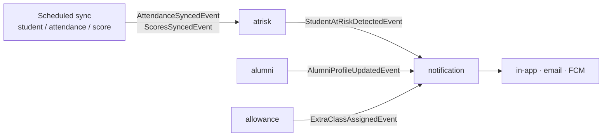

# Architecture

## Why a modular monolith

HRD Intelligence's features share the same core data. Allowances need scores and attendance, at-risk detection needs
attendance and scores, and the dashboard needs almost everything. As separate microservices, almost every request
would call several other services over the network.

So we run **one Spring Boot application** split into **modules**:

- **one deployment, one database, one transaction**: simple to run, debug and test
- **clear ownership**: each team member owns whole modules
- **enforced boundaries**: Spring Modulith fails the build if one module reaches into another's internals, so a module
  can later be extracted into its own service if ever needed

## Modules

```
src/main/java/com/kshrd/hrdintelligence/
├── HrdIntelligenceApplication.java
├── shared/          OPEN module: BaseEntity, ApiResponse, PageResponse, exceptions, CurrentUser, Role
├── config/          security (JWT), JPA auditing, async + scheduling, OpenAPI
├── integration/     HTTP clients for the external RDA and Assessment APIs
├── student/         student profiles (synced from Assessment API)
├── attendance/      attendance records (synced from RDA API)
├── score/           academic scores, weights, totals, ranks
├── allowance/       overtime, extra-class and monthly allowances, exports
├── feedback/        private instructor evaluations
├── atrisk/          at-risk detection and alerts
├── alumni/          alumni profiles, employment history, update requests
├── datamanagement/  files and folders, ownership and sharing (MinIO)
├── notification/    in-app, email and push notifications (listens to events only)
└── dashboard/       read-only analytics and report export
```

Each module has a `CLAUDE.md` with its business rules from the spec. It's useful for people too.

## Inside a module (MVC layers)

Every module uses the same layout. `student` is shown with example file names; today the folders are empty until the ERD is final:

```
student/
├── package-info.java        @ApplicationModule: marks this package as a module
├── CLAUDE.md                business rules for this module
├── api/                     PUBLIC: the only package other modules may use
│   ├── StudentApi.java          interface with read methods for other modules
│   ├── StudentSummary.java      small record shared with other modules
│   └── event/
│       └── StudentStatusChangedEvent.java   events other modules can listen to
├── controller/              REST controllers (/api/v1/...), @PreAuthorize
├── service/                 service interfaces
│   └── impl/                    implementations (@Service, @Transactional); also implement api/ interfaces
├── dto/
│   ├── request/                 request records + validation
│   └── response/                response records
├── model/                   JPA entities (extend BaseEntity)
│   └── enums/
├── mapper/                  MapStruct mappers (entity ↔ DTO)
└── repository/              Spring Data JPA repositories
```

Request flow: `controller → service → repository`. Controllers never use repositories or entities directly, and
only DTOs leave the service layer.

## The boundary rule

> Other modules may only use `<module>.api` and `<module>.api.event`.

```java
// ✅ allowed: in the allowance module
import com.kshrd.hrdintelligence.student.api.StudentApi;
import com.kshrd.hrdintelligence.student.api.StudentSummary;

// ❌ build fails: ModularityTests reports an illegal dependency
import com.kshrd.hrdintelligence.student.repository.StudentRepository;
import com.kshrd.hrdintelligence.student.model.Student;
```

Also:

- **Reference by id**: store `UUID studentId` in your entity, never `@ManyToOne Student`.
- **No cross-module SQL**: don't join or write another module's tables. Ask its `api/`.
- **`shared` is open**: any module may use it, so keep it free of business logic.

`src/test/java/.../ModularityTests.java` checks all of this on every `./gradlew check`. It also writes module diagrams
to `build/spring-modulith-docs/`.

## Events between modules

When something happens in one module that another must react to, the owner **publishes an event** instead of
calling the other module:

```java
// publisher (inside a @Transactional service method)
events.publishEvent(new StudentAtRiskDetectedEvent(studentId, level, type));

// listener (in another module)
@ApplicationModuleListener
void on(StudentAtRiskDetectedEvent event) { ... }
```

`@ApplicationModuleListener` runs **after the publisher's transaction commits**, **asynchronously**, in its own
transaction. Events are stored in the `event_publication` table (migration `V001`) until every listener succeeds,
and are re-delivered after a restart, so listeners must be idempotent.

Planned flows (from the spec; names may change with the ERD):



## External data sync

Student, attendance and score data comes from two external APIs:

| API | Provides | Used by |
|---|---|---|
| RDA API | attendance, student name, check-in / check-out | `attendance` |
| Assessment API | student info, scores, staff, class, course, org chart | `student`, `score` |

- `integration` contains **only the HTTP clients** (exposed through `integration.api`).
- Each owning module runs its **own scheduled sync** and upserts **its own tables** by external id, so running a sync
  twice is safe.
- After syncing, the module publishes an event so others (e.g. `atrisk`) can react.

## Security

Login, tokens and user management belong to the **external auth server**. This service is an **OAuth2 resource
server**:

1. Every `/api/**` request must carry `Authorization: Bearer <access token>`.
2. The token's signature, expiry, issuer and audience are validated (`JWT_ISSUER_URI`, `JWT_JWK_SET_URI`, `JWT_AUDIENCES`).
3. Roles are read from the token claim `realm_access.roles` (configurable in `app.security.role-claims`) and become
   `ROLE_ADMIN` / `ROLE_INSTRUCTOR`.
4. Controllers declare access with `@PreAuthorize("hasRole('ADMIN')")`.
5. Services get the caller from `CurrentUser` (`id()`, `email()`, `roles()`, `isAdmin()`).

401 and 403 responses use the same `ProblemDetail` JSON shape as other errors.

## API conventions

| Topic | Convention |
|---|---|
| Paths | `/api/v1/<resource>`, plural nouns |
| Success | `ApiResponse<T>` → `{ "message", "payload", "timestamp" }` |
| Lists | `ApiResponse<PageResponse<T>>` with `?page=0&size=20&sort=field,asc` |
| Errors | RFC 9457 `ProblemDetail` → `{ "title", "status", "detail", "timestamp", "errors"? }` |
| Validation | `400` with an `errors` map of field → message |
| Not found / conflict / rule broken | `404` / `409` / `422` |

## Database

- PostgreSQL. Schema managed **only** by Flyway (`src/main/resources/db/migration`), and Hibernate only validates.
- Migration name: `V<NNN>__<module>_<description>.sql`. Applied migrations are never edited.
- Every table has `id UUID`, `created_at`, `updated_at`, `created_by`, `updated_by`, `version` (from `BaseEntity`).
- Tables and columns follow the team **ERD** (to be added to `docs/`).

## Environments

| Profile | Where | Database | Swagger | Logs |
|---|---|---|---|---|
| `dev` | your machine | docker-compose Postgres | on | text, DEBUG for app |
| `test` | `./gradlew test`, CI | Testcontainers | n/a | text |
| `staging` | Kubernetes | managed Postgres | on | JSON (ECS) |
| `prod` | Kubernetes | managed Postgres | off | JSON (ECS) |

All environment-specific values come from env vars (see `.env.example`). Nothing secret is committed.
